<p align="center"></p>

# E-Ink Mode

**A quieter Mac in one click.** Switch to grayscale, take a short color break, or run timed focus sessions from your menu bar.

For macOS 13 Ventura or newer (Apple silicon and Intel) or Windows 10/11 x64 · **Beta**

**Latest Mac release: [0.10.0-beta.4](https://github.com/marcveihl/eink-mode/releases/tag/v0.10.0-beta.4)** — focus without grayscale, independent Pomodoro timers, and compact General settings.

**Windows beta:** see [Windows (beta)](#windows-beta) below for its separate release and installer.

[Download for Mac](https://github.com/marcveihl/eink-mode/releases/download/v0.10.0-beta.4/E-Ink-Mode-0.10.0-beta.4.zip) · [Release notes](https://github.com/marcveihl/eink-mode/releases/tag/v0.10.0-beta.4) · [User guide](docs/USER-GUIDE.md) · [Changelog](CHANGELOG.md) · [Roadmap](docs/ROADMAP.md)

<p align="center">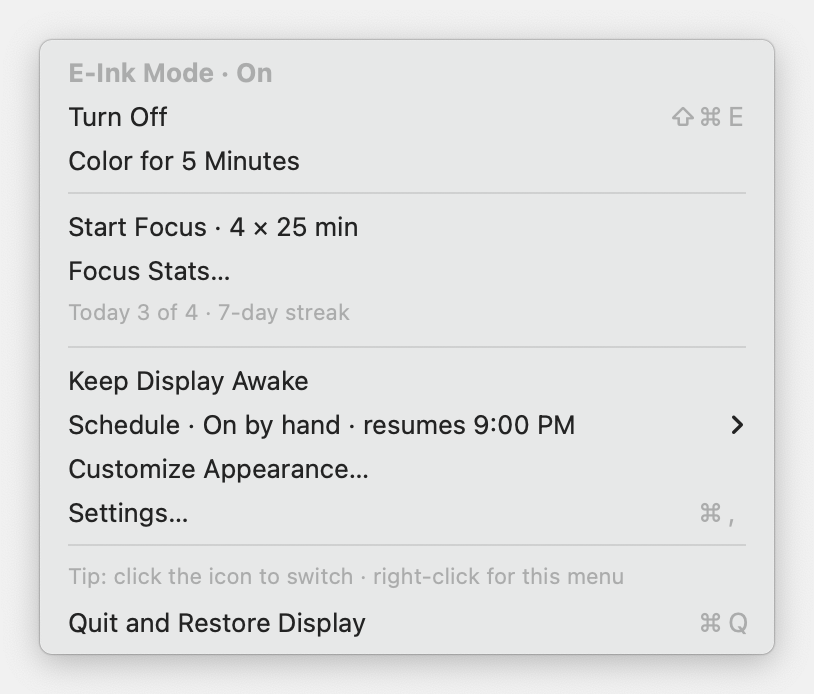</p>

## What it does

Color is what makes badges, feeds, and notifications pull at your attention. E-Ink Mode switches your Mac to grayscale, like an e-reader, so the screen fades into the background and the work comes forward. It's one click to turn on, and turning it off puts your display back exactly as it was.

### One-click grayscale

Switch from the menu bar or with **⌘⇧E** from any app. Grayscale is the only thing that changes by default. You can also opt in to dimming the screen, hiding the Dock, or reducing motion and transparency. A 10-second preview on first launch shows the effect before you commit.

### Color for 5 minutes

Need to check a photo, a chart, or a color-coded calendar? **Color for 5 Minutes** brings color back briefly, then returns to grayscale on its own. A countdown in the menu shows how long is left, and your other settings stay as they are.

### Focus sessions for studying

**Start Focus** runs a Pomodoro-style round: four 25-minute focus sessions separated by 5-minute breaks. By default, the timers leave your display alone. Enable **Settings → Focus → Use grayscale during focus** for automatic grayscale focus and color breaks. A soft sound marks each phase change, and a countdown sits next to the menu bar icon. You can pause and resume, skip a break, or stop early (minutes you already focused still count). Changing grayscale or turning E-Ink Mode off keeps the timer running and releases automatic display switching for that round.

<p align="center">
  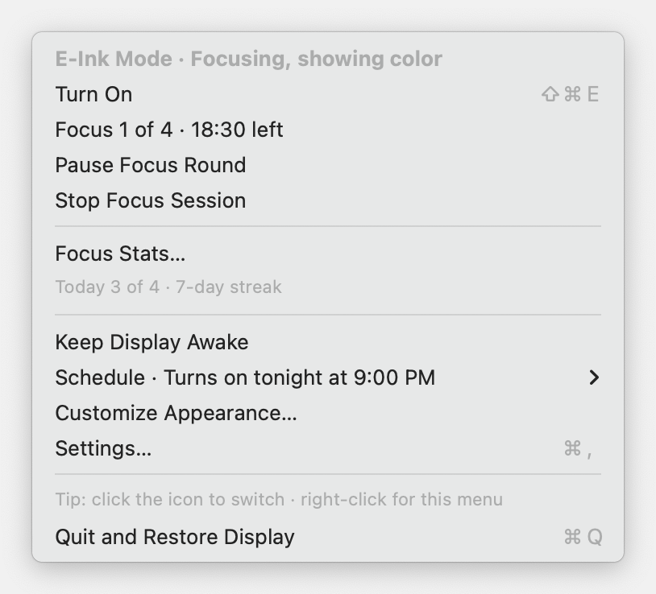
  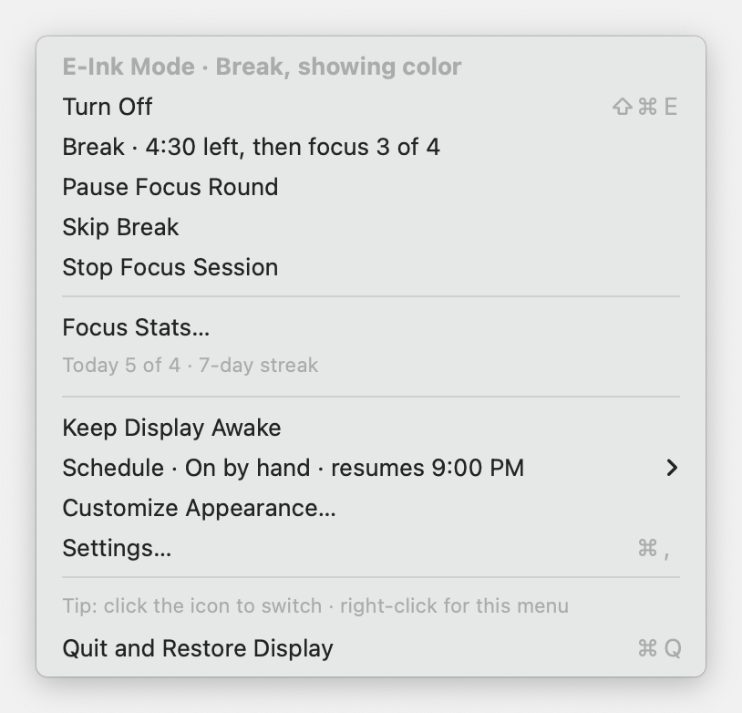
</p>

### A daily tracker that keeps you going

**Focus Stats** shows today's completed timer sessions against a daily goal (4 by default, and you can change it). It also shows your current and best streak, this week, retained totals, and your best day, with a 7-day chart and a short nudge suited to the moment, like *One more session to reach today's goal*. Up to 800 recorded days stay on your Mac. Each day's goal is preserved, so changing today's target doesn't rewrite past achievements. Older records with unknown goals are excluded from historical goal counts. These statistics describe timer activity, not measured attention.

<p align="center">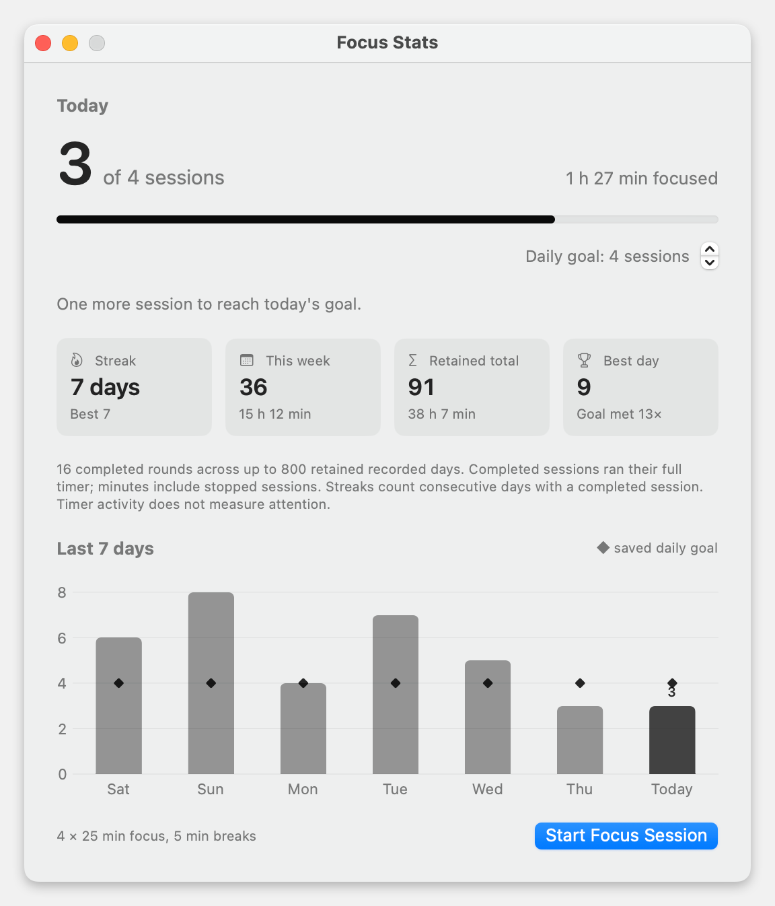</p>

### An icon you can read at a glance

The menu bar icon is **unshaded** while your screen is in color, **shaded** while it's grayscale, and **half-shaded** during temporary color (a color peek or a break in a grayscale focus round). **Wildcat mode** swaps the dot for a wildcat head that follows the same rule. Go 'Cats!

<p align="center">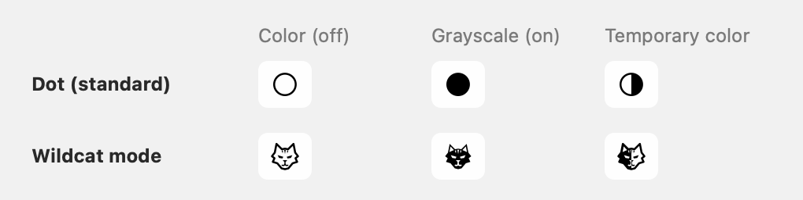</p>

### And the rest

- **Keep Display Awake:** a switch in the menu that stops the display sleeping and the screen saver starting while you read. It lasts until you switch it off, and quitting always releases it.
- **Evening schedule:** turn on at 9 PM and off at 7 AM (or your own times). The menu tells you what's next, such as *Turns on tonight at 9:00 PM*, and switching by hand always wins.
- **Your display always comes back:** your original settings are saved before anything changes. Quitting, logging out, updating, and even a crash all lead back to exactly how your Mac looked before.
- **Compact General settings:** grouped controls and expandable tips keep the window shorter; extra details scroll within the pane.
- **Update checks built in:** the app checks for new versions. Install this unsigned beta using the download or Terminal installer; in-app installation requires a signed release with a configured publisher identity.

See the [user guide](docs/USER-GUIDE.md) for every control, setting, and guarantee in detail.

## Install

Download [E-Ink-Mode-0.10.0-beta.4.zip](https://github.com/marcveihl/eink-mode/releases/download/v0.10.0-beta.4/E-Ink-Mode-0.10.0-beta.4.zip), unzip it, and move **E-Ink Mode.app** to **Applications**. The ZIP supports both Apple silicon and Intel Macs. Its [SHA-256 checksum](https://github.com/marcveihl/eink-mode/releases/download/v0.10.0-beta.4/E-Ink-Mode-0.10.0-beta.4.zip.sha256) is available alongside the download.

Beta.4 is not Developer ID signed or notarized. If macOS blocks a browser download, attempt to open the app, then use **System Settings → Privacy & Security → Open Anyway**. Signing is deferred until a later release.

Prefer Terminal? Review the [published installer](https://github.com/marcveihl/eink-mode/releases/download/v0.10.0-beta.4/install.sh), then run:

```sh
curl -fsSL https://github.com/marcveihl/eink-mode/releases/latest/download/install.sh | bash
```

This beta's installer verifies the exact archive checksum and signature integrity and preserves quarantine. Install future updates using the download or installer command while signing is deferred; the in-app installer requires a configured publisher identity.

## Use

Click the **○** in the menu bar (it becomes **●** while your screen is grayscale) to turn the mode on, start a focus session, or change settings.

- Enable **Settings → General → Behavior → Click icon to toggle E-Ink Mode** for one-click toggling. Right-click, Control-click, or hold for about a second to open the menu.
- Keep **Appearance → Grayscale** on for normal grayscale switching. **Focus → Use grayscale during focus** is a separate setting and defaults off.
- Choose **Color for 5 Minutes** when you need color; **Resume grayscale** ends it early.
- Enable **Open at login** if you want the schedule to run each day.
- Choose **Quit and Restore Display** before uninstalling.

See the [user guide](docs/USER-GUIDE.md) for focus controls, stats, shortcuts, Wildcat icons, and troubleshooting.

## Privacy and limitations

Settings and focus history stay on your Mac. There are no accounts or analytics. Update checks and downloads contact GitHub; automatic checks can be disabled.

The app saves your original display settings for restoration. After a crash, it offers recovery on the next launch. Disconnected displays may need reconnecting before restoration can finish.

Brightness support varies by display. Night Shift, f.lux, and notification settings are managed separately. Schedules require the app to be running. Focus stats record elapsed timer sessions, including catch-up after sleep—not measured attention.

## Windows (beta)

The same one-click grayscale switch, ported to Windows 10/11 (x64) on top of Windows' own Color Filters. This is a separate, earlier-stage beta — see [what's not here yet](#not-yet-on-windows) below.

<p align="center">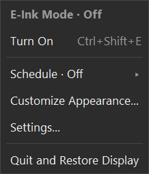 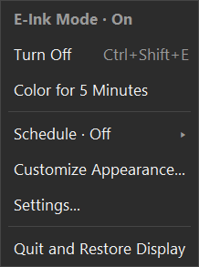</p>

### Install

1. Download `EInkMode-Setup-0.1.0.exe` from the [Windows beta release](https://github.com/marcveihl/eink-mode/releases/tag/windows-v0.1.0-beta.1) and run it. No administrator rights are needed — it installs for your user only, into `%LOCALAPPDATA%\Programs\E-Ink Mode`.
2. **Windows SmartScreen will probably warn you** ("Windows protected your PC") because this build isn't code-signed yet. Click **More info**, then **Run anyway**.
3. Choose **Install for me only**, then finish the wizard. It offers a Start Menu shortcut and an optional desktop shortcut (unchecked by default).

<p align="center">
  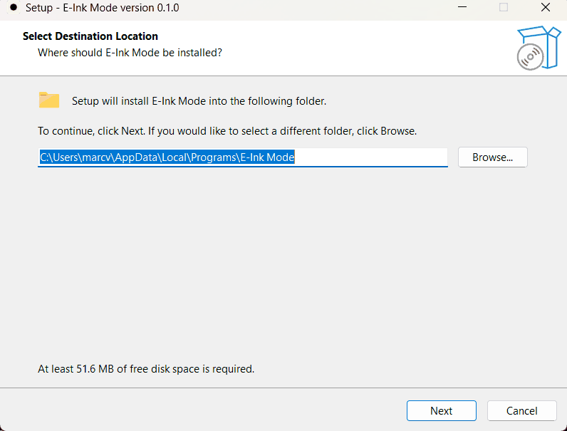
  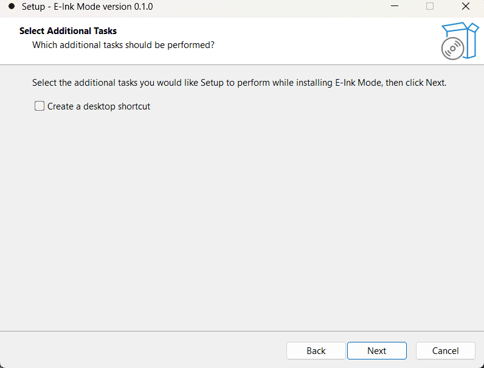
  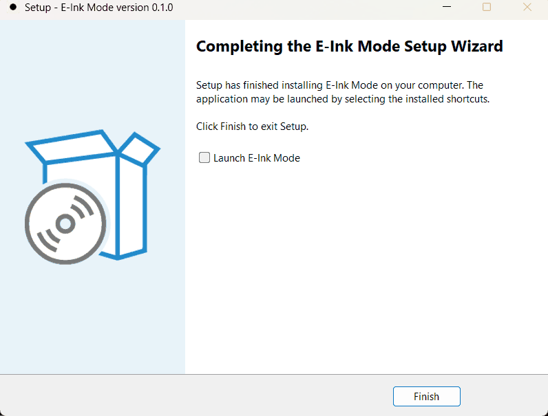
</p>

### First run

The first launch shows a short Welcome guide with a live 10-second grayscale preview. After that, look for **○** near the clock — it fills in (**●**) while your screen is grayscale, and shows **◐** during a temporary color break. Click it for the menu: Color for 5 Minutes, Schedule, Customize Appearance…, Settings…, and Quit and Restore Display.

<p align="center">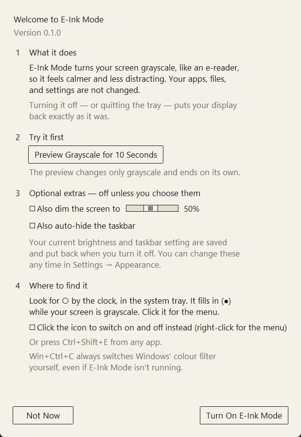</p>
<p align="center">
  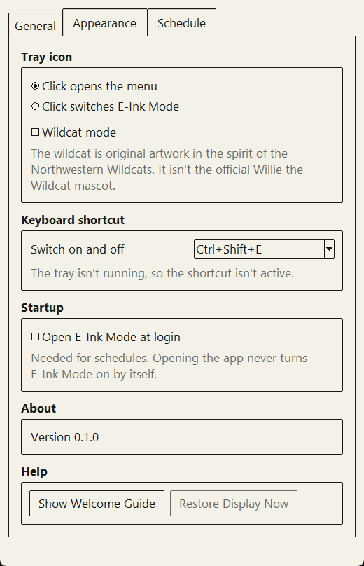
  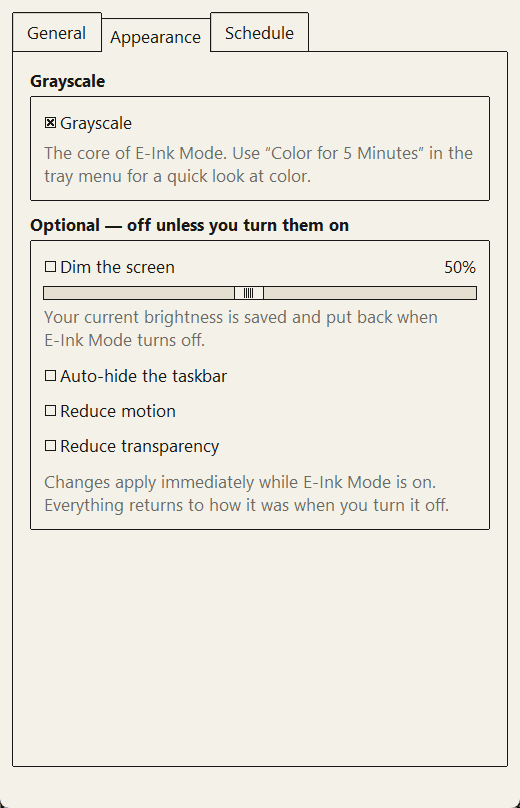
  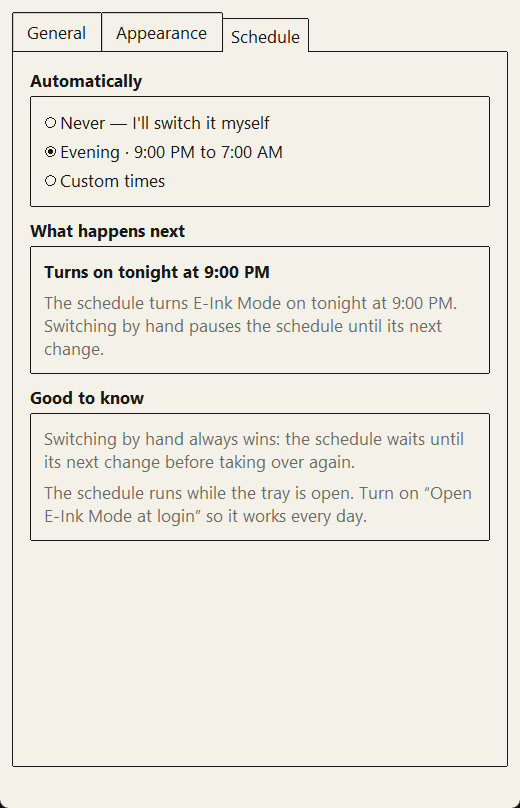
</p>

### Escape hatch

If E-Ink Mode is ever unresponsive, **Win+Ctrl+C** is the OS's own toggle — it works whether or not the tray is running.

### Not yet on Windows

Focus sessions and stats, the auto-updater, and code signing. Everything else above works on Windows too: one-click grayscale, Color for 5 Minutes, the evening schedule, and the optional extras (dimming, taskbar auto-hide, reduce motion and transparency). The Windows beta has its own installer, tray, and `eink.exe` CLI — see [`windows/README.md`](windows/README.md) and its [changelog](windows/CHANGELOG.md).

## Build

Requires Xcode command-line tools with Swift 5.9+ and Python 3. No third-party dependencies.

```sh
./scripts/test.sh
./scripts/build.sh
```

[CLI reference](docs/USER-GUIDE.md#for-developers) · [Release guide](docs/RELEASING.md) · [Beta testing](docs/BETA-TESTING.md) · [QA checklist](docs/QA.md)

Windows build: see [`windows/README.md`](windows/README.md#building-the-installer) (`windows/build.ps1`).
